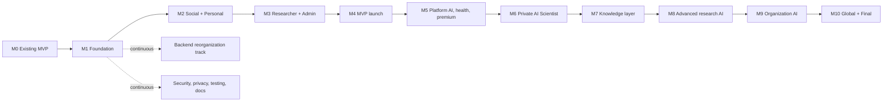

# Human Healthspan Scientific AI Network
# Development Roadmap

**Document:** Development Roadmap (`docs/DEVELOPMENT_ROADMAP.md`)
**Status:** Planning document. Every item below is **Planned** unless it is listed in the Milestone 0 baseline.
**Based on:**
- Consolidated Master Blueprint, Version 1.0 (product phases 0 to 8, MVP scope, risks, success measures, open decisions)
- System Development Architecture, Version 1.0 (target repository, technology decisions, migration strategy, engineering phases 1 to 8)

**Scope:** From the existing MVP, through the first public MVP launch, to final completion of the full platform.

> Documentation rule (from the architecture): a planned feature must not be documented as implemented. Update the status column only after the milestone gate has passed.

**Implementation note:** Shared identity/session and database foundations, text-only
messaging, and initial General AI/Scientist chat slices are present in this checkout ahead of
their full milestone gates. This does not mark M2, M4, or M6 complete: production identity,
researcher approval workflows, retrieval, launch hardening and the remaining milestone criteria
are still outstanding. The owner retired the separate legacy MVP as a migration source; M1 maps
the current checkout and does not require legacy compatibility.

---

# 1. How to Read This Roadmap

The two source documents each define eight phases, and they are not the same list.

| Source | Phase lens | Example |
|---|---|---|
| Blueprint V1.0 | Product capability | Phase 4 is the Private AI Scientist foundation |
| Architecture v1.0 | Engineering migration | Phase 2 is creating the Social Portal |

This roadmap merges them into one sequence of **milestones (M0 to M10)**. Each milestone states which blueprint phase and which architecture phase it delivers. Milestones are named M-numbers on purpose so they cannot be confused with the blueprint version number.

## 1.1 Sizing, not dates

No calendar dates are given. Team size, funding and the resolution of open decisions are not known, and any date would be invented. Each milestone carries a relative size instead.

| Size | Meaning |
|---|---|
| S | Small, a focused effort on one area |
| M | Medium, several workstreams in parallel |
| L | Large, cross-cutting, several teams or a long single-team effort |
| XL | Very large, research-grade or ecosystem-scale work |

Convert sizes to dates only after the team and the Milestone 1 backlog exist.

## 1.2 Reconciliation decisions

Where the two documents ordered work differently, this roadmap made the following choices. They are recommendations and can be reversed.

| # | Decision | Reason |
|---|---|---|
| 1 | Backend reorganization (architecture Phase 6) runs as a **continuous track** from M2, not as a late phase. | The portals depend on stable API boundaries, shared authorization and audit before they can be split safely. |
| 2 | **Production-readiness checks gate every public release**, not only the last one. A full assessment is required before the MVP launch (M4). | Security, privacy and backup cannot be added after real users exist. |
| 3 | The AI gateway and retrieval foundations already in the MVP are **moved into `ai/` early** (M4) as thin slices. The AI is then deepened over M5 to M9. | The blueprint MVP includes a General AI and a restricted Private AI Scientist prototype. |
| 4 | **Health-record features beyond foundations wait** until consent, sharing and audit controls are verified (M5). | Personal health data boundaries are an open decision and health data must stay private by default. |
| 5 | The existing admin application keeps running until the React + Vite replacement reaches full parity (M3). | Moderation and administration are needed before any public launch. |
| 6 | Premium features are built on a **backend entitlement foundation** at M3 and switched on commercially at M5. | Pricing and sustainability are open decisions, and the blueprint says to validate value before monetizing. |

---

# 2. Roadmap at a Glance

| Milestone | Name | What it means | Blueprint phase | Architecture phase | Size |
|---|---|---|---|---|---|
| **M0** | Existing MVP baseline | The current working system, preserved | Existing | Existing | n/a |
| **M1** | Foundation and inventory | Everything mapped, tooling and decisions in place | 0 | 1 | M |
| **M2** | Social and Personal portals | Two independent Next.js portals on shared identity | 1 | 2, 3 | L |
| **M3** | Researcher portal and Admin | Third portal, organizations, React + Vite admin | 2 | 4, 5 | L |
| **M4** | **MVP launch** | Hardened public release with AI thin slices; research access remains permission-gated | 3, 4 (thin) | 6, 7 (initial), 8 (initial) | L |
| **M5** | Platform AI, health records, premium | General AI matures, health records v1, payments | 3 (depth) | 7 (part), Section 13 | L |
| **M6** | Private AI Scientist foundation | Secure scientific corpus, evaluation, expert review | 4 | 7 (part) | XL |
| **M7** | Scientific knowledge layer | Evidence registry, entities, publications | 5 | 4, 7 (part) | L |
| **M8** | Advanced research AI | Agents, analysis tools, fine-tuning where justified | 6 | 7 (part) | XL |
| **M9** | Organization AI and institutions | Per-organization AI, enterprise administration | 7 | 7 (part) | XL |
| **M10** | Global ecosystem and **final completion** | Interoperability, partnerships, final production readiness | 8 | 8 (final) | XL |

## 2.1 Parallelism

Milestones are sequential at the level of gates, but their workstreams overlap.

- Within M2, `social-web` and `personal-web` can proceed in parallel once shared authentication is verified.
- Within M3, the Admin migration can proceed in parallel with the Researcher Portal.
- From M5, the General AI workstream and the health-records workstream are independent.
- M6, M7 and M8 can overlap at the edges, but M8 (training and fine-tuning) must not start until the M6 evaluation datasets exist.

---

# 3. Milestone 0: Existing MVP Baseline

The existing MVP is the foundation of the project. Nothing in it may be replaced without a verified migration.

| Existing location | Contents | Preserved until |
|---|---|---|
| `apps/web` | Next.js member application | Parity reached in M2 and M3 |
| `apps/admin` | Next.js admin application | Parity reached in M3 |
| `apps/api` | FastAPI backend, domain models, auth and security foundations, audit services | Moved to `api/` safely in M3 or M4 |
| `packages/ui` | Shared UI package | Preserved and extended |
| `infra/postgres` | Database infrastructure and migrations | Preserved |
| AI gateway, retrieval | Existing AI foundations | Reused and moved in M4 |
| Tests and Docker setup | Existing test suites and development containers | Preserved and expanded |

Current working features (social, research, AI gateway and retrieval foundations, authentication and authorization, audit) are the starting inventory for M1.

---

# 4. Milestone 1: Foundation and Inventory

**Goal:** Know exactly what exists, agree where it goes, and put tooling and decisions in place without disrupting the MVP.
**Maps to:** Blueprint Phase 0, architecture Phase 1. **Size:** M.

## 4.1 Workstreams

| Area | Work |
|---|---|
| Inventory | List all existing frontend routes, API endpoints, domain models, services, tests and Docker configuration. Assign each feature to a target portal and API domain. |
| Safety net | Add characterization tests for current behavior before changes. Establish CI running the current repository tests. |
| Tooling | Introduce pnpm workspaces and Turborepo, ESLint, Prettier, Vitest and Playwright alongside the existing setup. Keep the Python toolchain separate. |
| Packages | Create skeletons for `ui`, `design-tokens`, `api-client`, `auth-client`, `shared-types`, `validation`, `shared-config` and `testing`. |
| Documentation | Create the `docs/` set and the root `AGENT_RULE.md` with the mandatory rules. Write `MIGRATION_PLAN.md`. |
| Product artifacts | Complete the blueprint's eight next artifacts: PRD, portal and access specification, system architecture, domain model and ERD, API specification, three-component AI architecture, security, privacy and scientific governance, MVP backlog. |
| Decisions | Record the owner-approved M1 decisions in `DECISIONS.md`; carry forward the remaining open decisions in Section 16. |

## 4.2 Deliverables

- Current feature inventory and route/model target map.
- Repository migration plan and target workspace structure.
- Approved PRD, MVP backlog and threat model.
- `AGENT_RULE.md` committed at the repository root.

## 4.3 Exit gate

- Every current route, endpoint and model is mapped to a target location; legacy parity is explicitly out of scope.
- CI is green on the current repository baseline.
- The MVP-blocking decisions are recorded.
- The backlog for M2 and M3 is estimated and approved.

---

# 5. Milestone 2: Social and Personal Portals

**Goal:** Split the member application into two independent portals that share one identity.
**Maps to:** Blueprint Phase 1, architecture Phases 2 and 3. **Size:** L.

## 5.1 Shared identity first

Build this before either portal is migrated.

- Single account across all portals.
- Trusted application origins, secure sessions, token lifecycle and refresh behavior.
- Logout propagation, CSRF protection, cookie security and redirect validation.
- No long-lived tokens in browser local storage.
- Backend remains the authority for every permission.

## 5.2 Social Portal (`apps/social-web`, Next.js + TypeScript)

| Area | Scope |
|---|---|
| Community | Feed, posts, questions, comments, reactions, topics, communities, discussions |
| Events | Create, discover, register and discuss basic community events; invitations and notifications |
| Discovery | Basic search, recommended content |
| Safety | Content reporting and moderation hooks |
| SEO | Server-side rendering, dynamic metadata, canonical URLs, sitemap, robots, structured data where suitable |

Private content must never become indexable because pages are server-rendered. This needs an explicit test.

## 5.3 Personal Portal (`apps/personal-web`, Next.js + TypeScript)

| Area | Scope |
|---|---|
| Profile | Personal profile, preferences, profile visibility |
| Personalization | Saved content, followed topics and communities, personal dashboard |
| Professional profile | Education, experience, verification states (verified and unverified) |
| Activity | Activity history linking to original resources |
| Health foundations | Data model, private-by-default rule, consent records and access auditing only. No broad health-record feature surface yet. |

Basic direct and group text messaging is included in M4. Rich audio, video, media and resource-sharing capabilities follow in M5.

## 5.4 Backend (continuous track)

- Add the new route areas under `/api/v1/user/social/` and `/api/v1/user/personal/`.
- Preserve current endpoints as features are extended; legacy compatibility adapters are out of scope.
- Place new logic in the target domain modules, not in the route handlers.

## 5.5 Migration method

Follow the architecture's order: build each portal feature, test it against current API contracts and milestone acceptance criteria, then move on. Retire or repurpose current applications only after their replacements are verified.

## 5.6 Exit gate

- Register once and sign in to both portals with the same account.
- All delivered features pass their current-contract regression and milestone acceptance tests.
- Both portals build and deploy independently.
- Private content is verified as not indexable; cross-user access attempts are denied.
- Accessibility and routing tests pass for both portals.

## 5.7 Approved backlog estimate

Owner-approved relative sizing for planning; estimates are not person-days and workstream sizes
are not additive. Existing shared registration/session, basic messaging, and portal foundations
are counted as completed baseline work. Re-estimate if implementation reveals material complexity.

| Work package | Size |
|---|---|
| Shared identity hardening | L |
| Social community core: feed, posts/questions, comments/reactions, topics, communities, membership, reporting and moderation hooks | L |
| Social discovery, events, notifications and SEO | M |
| Personal profile, preferences, saved/followed content, dashboard, professional profile and activity | M |
| Private-by-default health foundations, consent and access auditing | M |
| Cross-portal integration, independent builds/deployments, accessibility and acceptance tests | L |

**Milestone estimate:** L, consistent with the roadmap overview. Identity is the prerequisite;
Social and Personal feature work can then proceed in parallel, followed by cross-portal acceptance.

---

# 6. Milestone 3: Researcher Portal and Admin

**Goal:** Add the researcher environment, basic organizations and the new administration application.
**Maps to:** Blueprint Phase 2, architecture Phases 4 and 5. **Size:** L.

## 6.1 Researcher Portal (`apps/researcher-web`, Next.js + TypeScript)

| Area | Scope |
|---|---|
| Entry | Research community discovery, applications and invitations, researcher profiles |
| Workspace | Basic project workspace, tasks, documents, role-based access |
| Evidence | Improved evidence management using the existing research features |
| Organizations | Basic organization profiles, controlled membership, roles; advanced institutional features later |
| Research events | Create, discover, register and discuss research events |
| Organization AI | Data model and access-boundary foundations only |
| Work history | Auditable record of contributions; corrections by amendment, not alteration |

## 6.2 Admin Application (`apps/admin`, React + Vite + TypeScript)

Migrate incrementally from the existing Next.js admin, preserving every workflow.

| Module | Notes |
|---|---|
| Users, organizations, communities, events | Management and oversight |
| Moderation | Posts, discussions, reports, complaints, actions |
| Subscriptions | Entitlement administration foundation |
| AI monitoring | Usage and cost views as the AI services come online |
| Audit and security | Administrative audit logs, permission changes, security events |

The Admin API must stay compatible during the front-end migration.

## 6.3 Backend (continuous track)

- Add `/api/v1/user/researcher/` and `/api/v1/admin/`.
- Build the **centralized entitlement service** (foundation only; payment processing arrives in M5).
- Add organization membership, roles and resource-level permissions with strict tenant isolation.

## 6.4 Exit gate

- A researcher can apply, be admitted, create a project, assign tasks and attach documents.
- Cross-organization access attempts are denied in tests.
- The new Admin supports the documented M3 operations and passes their API/workflow acceptance
  tests. The retired legacy Admin is not an acceptance baseline.
- The original `apps/web` and old admin can be retired or repurposed.

### Current Admin scope acceptance (2026-11-11)

The legacy Admin source was retired by owner decision, so acceptance is against the documented M3
modules and current Admin API contract, not a byte-for-byte or behavior-for-behavior comparison with
the removed application.

| Admin module | Acceptance result | Evidence and limits |
|---|---|---|
| Authentication | Pass | Browser smoke verified sign-in for a verified allowlisted account, explicit denial for a signed-in non-admin, and server-side session revocation on sign-out. |
| Users and researcher access | Pass | Admin UI exposes account verification and researcher application decisions; API authorization/workflow tests pass. Verification is operator-recorded, not an email challenge. |
| Organizations and entitlements | Pass | UI covers request review, provisioned organization oversight, entitlement history/grant/revocation; API workflow tests cover entitlement gating and decisions. |
| Communities, events and moderation | Pass | UI exposes community approval, event cancellation, global/escalated reports and appeals; API tests cover decisions and audit records. Ordinary community moderation remains in community-scoped workflows. |
| AI monitoring | Pass for M3 | UI reports aggregate volume, outcomes, character counts and latency without prompt/answer exposure. Provider cost reporting is explicitly deferred to M4 by owner decision D8; costs are not estimated. |
| Audit and security | M3 audit subset passes | Identity, researcher, organization, entitlement, event, community and platform moderation decisions are available and tested. General security-event search is subsequent hardening per owner direction. |

Researcher admission, project/task/document flows and cross-organization denial pass the API tests;
the Researcher and Admin applications build. All M3 exit-gate criteria pass. AI provider cost
reporting is deferred to M4 by owner decision D8; production file scanning/storage and general
security-event search are subsequent hardening, not blockers for M3 completion.

## 6.5 Approved backlog estimate

Owner-approved relative sizing for planning; estimates are not person-days and workstream sizes
are not additive. Re-estimate if implementation reveals material complexity.

| Work package | Size |
|---|---|
| Researcher entry, applications/invitations, profiles and collaboration workspace | L |
| Organizations, invite-based roles, tenant isolation and pre-M5 entitlements | L |
| Admin authentication and user, organization, community, event, moderation, entitlement, audit and security workflows | L |
| Integration, API compatibility, cross-organization denial and acceptance/parity tests | L |

**Milestone estimate:** L, consistent with the roadmap overview. Researcher and Admin tracks may
overlap where their API and authorization contracts permit; tenant isolation is an acceptance gate.

---

# 7. Milestone 4: MVP Launch

**Goal:** Ship the hardened public release that matches the approved M1 MVP boundary and the blueprint's MVP scope. Social and Personal access is open to the general public; research resources remain permission-gated.
**Maps to:** Blueprint Phases 3 and 4 as thin slices, architecture Phases 6 and 7 (initial) and 8 (initial). **Size:** L.

## 7.1 MVP scope (blueprint scope aligned with approved M1 decisions)

| Area | MVP scope |
|---|---|
| General portal | Registration, profiles, interests, posts, questions, comments, topics, basic feed, communities, search |
| Personal portal | Personal profile, preferences, saved content, followed topics and communities, dashboard |
| Researcher portal | Community discovery, applications and invitations, researcher profiles, basic project workspace, role-based access |
| Organizations | Basic profiles and controlled membership |
| Events | Create, discover, register and discuss basic events |
| Messaging | Basic direct and group text messaging; richer media capabilities are deferred to M5 |
| General Platform AI | Public and common knowledge Q&A, approved web search, external model integration, source display |
| Private AI Scientist | Restricted prototype for approved research users: curated literature, private RAG, citations, a small set of research workflows |
| Governance | Core RBAC, audit logs, consent foundations, data separation, moderation and reporting |
| Organization-Specialized AI | Deferred. Pilot with one controlled organization only if justified. |

## 7.2 Work required

| Track | Work |
|---|---|
| Backend | Finish the API boundaries (Social, Personal, Researcher, Admin). Move `apps/api` to top-level `api/` only after import paths, Docker configuration, environment variables, migration paths, tests and deployment scripts are updated. |
| AI | Move the existing gateway and retrieval into `ai/gateway` and `ai/knowledge` behind stable internal interfaces. Build the General AI Q&A with source display and the restricted Private AI Scientist prototype. Keep the AI environments logically separate. |
| Governance | Permission-aware retrieval, AI permission tests, usage and cost monitoring, consent foundations |
| Hardening | Security assessment, privacy assessment, performance testing, backup and restore drills, monitoring and alerting, deployment automation, operational runbooks, incident response |
| Launch | Open Social and Personal access to the general public without a single designated launch community or geography gate; prepare moderation staffing and support. Seeded communities or opt-in early cohorts may support onboarding but must not restrict eligibility. |

## 7.3 End-to-end test suite

The ten flows listed in the architecture must pass before launch (the ones that depend on later features are marked).

1. Register once and access all three portals.
2. Publish a public post in the Social Portal.
3. Share a personal profile.
4. Create a research project.
5. Invite a member to an organization.
6. Assign a project task.
7. Verify a professional contribution.
8. Access health data using explicit permission (foundation level only at M4).
9. Create an organization AI instance (deferred beyond M4 unless the pilot proceeds).
10. Purchase a premium entitlement (entitlement foundation at M4, payments in M5).

## 7.4 MVP exit gate (the definition of "MVP complete")

- All MVP scope items above work end to end.
- Security and privacy assessments are complete with no open critical findings.
- Backup and restore have been tested.
- Cross-user, cross-organization and AI-retrieval isolation tests pass.
- Documentation matches what is actually implemented.
- The success measures in Section 15 have baselines and dashboards.

---

# 8. Milestone 5: Platform AI, Health Records and Premium

**Goal:** Mature the General AI, deliver health records safely, and enable the premium model.
**Maps to:** Blueprint Phase 3 in depth, architecture Section 13 and the remaining Personal Portal scope. **Size:** L.

| Track | Work |
|---|---|
| General Platform AI | Better citations and source verification, recommendations, content and research discovery, platform navigation help, evaluation set and quality monitoring |
| Personal AI | Personal assistance in the Personal Portal. It must not use health data without explicit consent. |
| Search and retrieval | Dedicated search infrastructure; vector retrieval reassessed for scale |
| Background processing | Queue and workers for notifications, email, file and media processing, indexing |
| Messaging | Richer messaging: audio, video, media and resource sharing |
| Health records v1 | Manual entry, document upload, categorization, history and graphs, controlled sharing with scoped, expiring and revocable links and access auditing. Device and wearable integrations are later. |
| Premium and payments | Switch on the entitlement system: create organization, create event, organization contributor badges, organization AI (as it becomes available). Payments, refunds and cancellations. |
| Badges | Centralized badge and certification service with organization-tied contributor badges |

**Gate:** The privacy and legal review of health-data handling is complete for all applicable jurisdictions in which the public service is available. Unauthorized health-data access tests and share-link tests pass. Pricing decision is made. The entitlement checks are enforced by the backend only.

---

# 9. Milestone 6: Private AI Scientist Foundation

**Goal:** Turn the restricted prototype into a secure, evaluated scientific research assistant.
**Maps to:** Blueprint Phase 4, architecture Phase 7 (part). **Size:** XL.

| Track | Work |
|---|---|
| Deployment strategy | Decide private deployment and provider contractual controls. Confidential data is not sent to an external provider without explicit authorization and safeguards. |
| Scientific corpus | Curated corpus with source, provenance, licensing and quality review |
| Retrieval | Production permission-aware RAG, hybrid search, citations |
| Workflows | Literature review, evidence assessment, research planning, basic hypothesis assistance |
| Evaluation | Evaluation datasets, benchmarks and reports in `ai/evaluation`; baseline for citation accuracy and retrieval relevance |
| Governance | Scientific advisory oversight, evidence policy, conflict-of-interest disclosure, expert review of consequential outputs |
| Data rights | Rules for what may enter the corpus or any training set: ownership, licensing, consent, project permission |

**Gate:** Leakage and permission-boundary tests pass. The evaluation baseline is recorded and targets are set. Expert reviewers are in place. The private AI cannot be reached through the General AI.

---

# 10. Milestone 7: Scientific Knowledge Layer

**Goal:** Make scientific knowledge traceable and structured.
**Maps to:** Blueprint Phase 5, architecture Phases 4 (publications) and 7 (part). **Size:** L.

| Track | Work |
|---|---|
| Evidence registry | Source, author, publication, date, study type, population, methods, limitations, provenance, review status |
| Structured entities | Entity extraction and resolution across documents |
| Knowledge graph | Evaluate Neo4j or an equivalent once concrete graph use cases exist; adopt only if the operational cost is justified |
| Publications | Researcher publication workflow: blogs, articles, summaries and reports with references and SEO-friendly metadata |
| Literature tools | Literature discovery and evidence classification in the Researcher Portal |
| Lineage | Version history and data lineage for research assets |

**Gate:** Evidence records are traceable to source. AI answers cite registry entries. Redundancy and quality checks operate on publications.

---

# 11. Milestone 8: Advanced Research AI

**Goal:** Extend the AI Scientist with agents, analysis tools and, where justified, model specialization.
**Maps to:** Blueprint Phase 6, architecture Phase 7 (part). **Size:** XL.

| Track | Work |
|---|---|
| Agents and tools | Specialized research agents with tool permissions and audit |
| Analysis | Data-analysis tools, research planning, experiment design support |
| Feedback loop | Approved expert feedback captured and reviewed before reaching any corpus, evaluation set or training pipeline |
| Training and fine-tuning | Only where evidence supports the investment. Requires datasets with explicit permissions, evaluation sets, training infrastructure, model registry, versioning, reproducibility and cost controls. |
| Evaluation | Continuous evaluation of factuality, evidence quality, citation accuracy, uncertainty calibration and task usefulness |

**Go or no-go for training:** Training starts only if M6 evaluation shows retrieval alone is insufficient for a defined task, the data rights are cleared, and the cost is approved. Personal health data is never used for training without separate, explicit consent and governance.

**Gate:** Training runs are reproducible; the model registry is in use; evaluation shows measurable improvement; no privacy incidents.

---

# 12. Milestone 9: Organization AI and Institutions

**Goal:** Give each organization its own governed AI environment and institution-ready administration.
**Maps to:** Blueprint Phase 7, architecture Phase 7 (part). **Size:** XL.

| Track | Work |
|---|---|
| Organization AI environments | Per-organization identity, knowledge sources, retrieval permissions, access policies, configuration, evaluation datasets, usage and cost records |
| Pilot | One controlled organization first, then general availability |
| Isolation | One organization must never reach another's private AI information without explicit authorization. Isolation tests are mandatory. |
| Shared learning | Feedback, consent, de-identification or aggregation, and review before anything enters shared corpora |
| Customization | Prompt customization, RAG, and (only if supported) fine-tuning, kept clearly distinct. A knowledge base does not mean the organization owns a trained model. |
| Enterprise administration | Organization billing, advanced roles and governance, integrations, AI monitoring per organization |
| AI console | Optional `apps/ai-console` if operations justify it; otherwise keep using the Admin application |

**Gate:** Pilot organization completes real workflows. Cross-organization leakage tests pass. Usage and cost reports match billing. The organization AI cost model is sustainable.

---

# 13. Milestone 10: Global Ecosystem and Final Completion

**Goal:** Open the platform to partners and complete final production readiness.
**Maps to:** Blueprint Phase 8, architecture Phase 8 (final). **Size:** XL.

| Track | Work |
|---|---|
| Interoperability | Public APIs, institutional integrations, data exchange standards |
| Partnerships | Research partnerships, funding and opportunity networks |
| Publication site | Astro-based publication or documentation website, only if justified |
| Mobile | Evaluate React Native or native apps after validation of demand (responsive web is the default) |
| Scale | Independent scaling of front ends, API, AI workloads, workers, search, file processing and training. Extract microservices only where real operational need exists. |
| Final readiness | Repeat the full security and privacy assessments, performance and disaster-recovery testing, monitoring review, documentation audit |

## 13.1 Final completion criteria

The project is complete when all of the following are true.

- Three independent Next.js portals and the React + Vite Admin application are in production, and the original MVP applications are retired.
- The Backend and AI platform live in separate top-level `api/` and `ai/` areas with stable interfaces.
- The General Platform AI, Private AI Scientist and Organization-Specialized AI are live and logically separated.
- Organization data isolation and personal health-data protections are verified by automated tests.
- The entitlement and payment system is live and enforced by the backend.
- Evidence provenance, evaluation and expert oversight operate as continuous processes.
- Interoperability and partnership interfaces are available.
- Security, privacy, performance and recovery assessments are current with no open critical findings.
- All documentation in `docs/` matches the implementation.

---

# 14. Continuous Tracks (Every Milestone)

| Track | Standing requirements |
|---|---|
| Backend reorganization | Strangler approach. Preserve request and response behavior. Add compatibility adapters. Remove obsolete routes only after migration and tests. |
| Security | Backend-enforced authorization, rate limiting, audit logs, MFA support, secure file ingestion, incident response |
| Privacy | Consent and purpose limitation, retention and deletion, health data private by default, no automatic training use |
| Testing | Frontend, backend, AI and end-to-end suites grow with every milestone. Add tests before removing any existing functionality. |
| Documentation | Update `ARCHITECTURE.md`, `API.md`, `DATA_MODEL.md`, `AI_ARCHITECTURE.md`, `SECURITY.md` and this roadmap at each gate. Maintain `LAST_CHANGE.md`. |
| Observability | Structured logs, metrics, tracing, security monitoring, AI cost and quality monitoring |
| CI/CD | Independent builds and deployments for each application; automated checks before merge |
| Migration rules | Preserve MVP behavior, database migrations and API compatibility; follow `AGENT_RULE.md` |

---

# 15. Success Measures by Milestone

Measures are from blueprint Section 16. Targets must be set during M1 and M4 using real baselines.

| Milestone | Measures to track |
|---|---|
| M2 to M3 | Parity test pass rate, deployment independence, authorization test pass rate |
| M4 | Active members, repeat participation, community retention, event participation, moderation response, permission incidents (target none), citation accuracy baseline |
| M5 | Paid conversion where applicable, retrieval relevance, consent compliance, health-data access audit completeness |
| M6 | Citation accuracy, retrieval relevance, expert-rated usefulness, leakage incidents (target none) |
| M7 | Evidence-linked discussions, source completeness, reproducibility indicators |
| M8 | Task success, evaluation improvement, expert correction acceptance, training reproducibility |
| M9 | Adoption by authorized members, workflow time saved, leakage incidents (target none), governance compliance, operating cost per active workflow |
| M10 | Institutional adoption, partnership activity, sustainability indicators, recovery test results |

---

# 16. Decisions and When They Are Needed

The owner-approved M1 decisions are recorded in `DECISIONS.md`. The blueprint originally listed the
audience, launch community, geographic and MVP scope as open decisions; those product choices are
now resolved as shown below. Legal and regulatory review remains a launch prerequisite and is not
replaced by the onboarding acknowledgment.

| Decision | Needed by |
|---|---|
| Target audience and launch community — decided: general public, no single launch community | Decided in M1 |
| MVP boundary, including basic text messaging — decided: see `DECISIONS.md` D3 and M4 scope | Decided in M1 |
| Geographic availability — decided: no regional restrictions or geoblocking | Decided in M1 |
| Applicable legal and regulatory review for public availability | Before M4 launch |
| Restricted research-community membership workflow | M2; policy principle decided in `DECISIONS.md` D4 |
| Community moderation/reporting and appeals workflow | M2; policy decided in `DECISIONS.md` D5 |
| Activity-based Contributor/Research Contributor badge criteria | M2; principle decided in `DECISIONS.md` D6 |
| Organization onboarding and tenant model | M3; workflow and creation entitlements decided in `DECISIONS.md` D7; checkout remains M5 |
| AI provider and deployment choices | M4 |
| Personal health and genomic data boundaries | M4 (policy), M5 (features) |
| Data ownership, licensing and IP policy | M4 |
| Pricing and sustainability | M5 |
| Model-training consent and cross-organization learning policy | M6 (policy), M8 (training) |
| Organization-specific AI tenancy and customization | M9 |

---

# 17. Principal Risks and Where They Are Handled

From blueprint Section 15 and the architecture's governance rules.

| Risk | Primary response | Milestone focus |
|---|---|---|
| Scope too broad | Hold the MVP boundary; phase everything else | M1, M4 |
| Cold start and low engagement | Seeded communities across topics, expert content, events and optional non-exclusive cohorts | M4, M5 |
| Medical or scientific misinformation | Evidence classification, source display, moderation, expert review | M4 to M7 |
| AI hallucination | RAG, citations, evaluation, human review for consequential output | M4 to M8 |
| Confidential research leakage | Separate AI environments, private indexes, audit, provider controls | M4, M6, M9 |
| Personal health and genomic privacy | Consent, data separation, jurisdiction-aware compliance | M2, M5 |
| IP disputes | Ownership, licensing, contribution records | M3, M9 |
| Unvalidated training data | Data-rights checks, provenance, training governance | M6, M8 |
| Scientific credibility | Advisory oversight, evidence standards, reproducibility | M6, M7 |
| Infrastructure complexity and cost | Modular monolith, managed services, measured scaling | All |
| Cross-organization learning leakage | Tenant isolation, consent, de-identification, audit | M9 |
| Migration regression | Characterization tests, compatibility adapters, retire only after parity | M2, M3, M4 |

---

# 18. Roadmap Maintenance

- Review this document at every milestone gate and update the status column.
- Mark a milestone **Complete** only when its exit gate is met and the documentation reflects the implementation.
- Record any change to the reconciliation decisions in Section 1.2 with the reason.
- Convert sizes to dates after M1, and re-estimate at each gate.
- Keep this file consistent with `ARCHITECTURE.md`, `MIGRATION_PLAN.md` and the blueprint version in force.

## 18.1 Status tracker

| Milestone | Status |
|---|---|
| M0 Existing MVP baseline | Existing |
| M1 Foundation and inventory | In progress (route/model map, decisions, and M2/M3 estimates are recorded; CI setup and its guideline update are deferred until after M4) |
| M2 Social and Personal portals | Planned |
| M3 Researcher portal and Admin | Complete (researcher admission/profile, organization and entitlement foundation, project collaboration, events, bounded private development file uploads, and Admin authentication/workflow acceptance meet the exit gate; AI provider cost reporting is deferred to M4 by D8; production file scanning/storage and general security-event search are subsequent hardening) |
| M4 MVP launch | Planned |
| M5 Platform AI, health records, premium | Planned |
| M6 Private AI Scientist foundation | Planned |
| M7 Scientific knowledge layer | Planned |
| M8 Advanced research AI | Planned |
| M9 Organization AI and institutions | Planned |
| M10 Global ecosystem and final completion | Planned |
