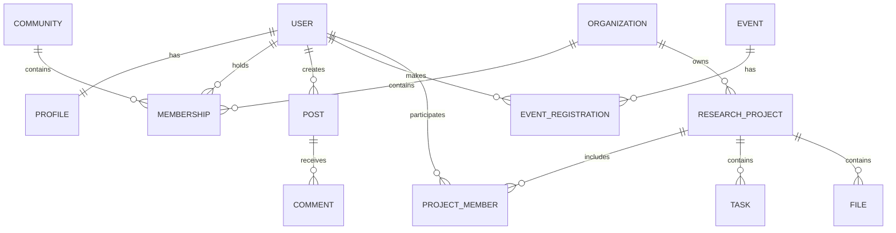

# MVP Product Specification
## Human Healthspan Scientific AI Network

<text color="secondary" size="sm">Product specification · Version 1.0 · November 2026 · Derived from the three project source documents</text>

<badge color="success">Proposed MVP baseline</badge> <badge color="info">M4 public launch</badge>

## 1. Product definition

The MVP should establish the first functioning version of the Human Healthspan Scientific AI Network: a platform connecting people, scientific communities, researchers, organizations, and AI-assisted knowledge discovery.

Its primary purpose is to demonstrate that:

1. People can discover, learn, publish, discuss, and connect around human healthspan and science.
2. Interested members can transition into professional research communities.
3. Approved researchers can collaborate through controlled research workspaces.
4. AI can help users understand scientific knowledge and assist approved researchers with literature-based workflows.
5. Personal information, research materials, and organizational knowledge remain protected by explicit permissions.

**The MVP is not the complete global scientific ecosystem.** It is the smallest credible system that validates the social-to-research progression and the usefulness of AI-assisted scientific collaboration.

This follows the central product progression in the blueprint:

**Discover → Learn → Connect → Participate → Collaborate → Research → Validate → Share appropriate knowledge.**

The MVP must demonstrate this progression without compromising privacy, scientific quality, or access control.

Sources: Product Blueprint, Sections 1, 2 and 12; Development Roadmap, Milestone 4.

### Current repository status (not a launch certification)

The checkout contains early development slices for shared cookie identity, direct/group text
messaging, a configurable General AI gateway, a gated prompt-only Scientist prototype and
consent-aware AI interaction records. These do not satisfy the full MVP objectives above:
community workflows, verified research approval, source-backed AI, launch security/privacy
review and production operations remain incomplete. The v0.4 legacy source is archived and
inventoried in `MIGRATION_PLAN.md`; production data and feature parity have not been verified.

---

## 2. MVP objectives and validation hypotheses

| Objective | What the MVP must prove |
|---|---|
| Community formation | Members can form and participate in focused scientific and healthspan communities. |
| Knowledge discovery | Members can discover relevant people, topics, discussions, and scientific information. |
| Research participation | Interested members can apply to research communities and obtain appropriate access. |
| Collaboration | Researchers can create projects, assign tasks, and share authorized documents. |
| General AI usefulness | Members receive useful, source-supported scientific and educational assistance. |
| Scientific AI feasibility | Approved researchers can use a restricted AI prototype for literature-based research workflows. |
| Trust and security | Access restrictions, auditability, and data separation work in practice. |

The MVP should prioritize meaningful participation and scientific collaboration rather than screen count, likes, or time spent on the platform.

---

## 3. Target users

The initial product supports five user groups.

| User group | Primary need | MVP experience |
|---|---|---|
| General members | Learn, discover, connect | Social Portal |
| Healthspan enthusiasts | Explore scientific and health topics | Social and Personal Portals |
| Researchers and scientists | Research and collaborate | Researcher Portal |
| Research community administrators | Manage membership and research activities | Researcher Portal and Admin |
| Platform administrators | Manage platform operations and safety | Admin Application |

Organizations are also supported as platform entities, with basic profiles and controlled membership.

**Approved M1 launch decision (D1):** Open the Social and Personal Portals to the general public across the stated topic areas, with no single designated launch community or invite-only public cohort. Researcher Portal spaces remain gated by verification and permissions. Seeded communities or opt-in early cohorts may support onboarding but must not restrict eligibility.

---

## 4. Product structure and portals

The platform consists of three independent user-facing portals and one administration application, all sharing one identity system and backend.

<box border radius="lg" padding={3} gap={3}>
  <title size="lg">Platform architecture</title>
  <box background="rgba(59,130,246,0.09)" radius="md" padding={3} align="center">
    **Shared identity and authentication**

    <text color="secondary" size="xs">One account · Common permissions · Shared backend</text>
  </box>
  <grid columns={2} gap={2}>
    <grid-item>
      <box background="rgba(59,130,246,0.08)" radius="md" padding={2} align="center">
        **Social Portal**

        <text size="xs" color="secondary">Discover and connect</text>
      </box>
    </grid-item>
    <grid-item>
      <box background="rgba(59,130,246,0.08)" radius="md" padding={2} align="center">
        **Personal Portal**

        <text size="xs" color="secondary">Identity and personalization</text>
      </box>
    </grid-item>
    <grid-item>
      <box background="rgba(16,185,129,0.09)" radius="md" padding={2} align="center">
        **Researcher Portal**

        <text size="xs" color="secondary">Research and collaboration</text>
      </box>
    </grid-item>
    <grid-item>
      <box background="rgba(148,163,184,0.13)" radius="md" padding={2} align="center">
        **Admin Application**

        <text size="xs" color="secondary">Governance and operations</text>
      </box>
    </grid-item>
  </grid>
  <box background="rgba(16,185,129,0.08)" radius="md" padding={3} align="center">
    **Shared backend and AI platform**

    <text size="xs" color="secondary">FastAPI · PostgreSQL · Authorization · Audit · AI gateway</text>
  </box>
</box>

### 4.1 Social Portal

**Purpose:** Public-facing community, knowledge discovery, and participation.

| Feature | MVP requirements |
|---|---|
| Registration | Create account and authenticate |
| Member profiles | Public profile, avatar, description |
| Interests | Select and follow scientific topics |
| Posts | Create, edit and view posts |
| Questions | Publish scientific and general questions |
| Comments | Participate in discussions |
| Reactions | Basic content reactions |
| Topics | Browse and follow topic categories |
| Feed | Basic feed from relevant followed content |
| Communities | Discover and join communities |
| Search | Search members, topics and communities |
| Events | Create, discover, register and discuss basic events |
| Messaging | Basic direct and group text messaging |
| Reporting | Report inappropriate content |

**Initial topic categories**

- Longevity and aging biology
- Biotechnology and bioengineering
- Genetics and genomics
- DNA and genome engineering
- Protein science
- Medicine and healthcare
- Brain and cognitive health
- Nutrition and metabolism
- Fitness and physical performance
- AI and computational biology

These categories derive from the blueprint's mission areas. They are not a commitment to launch a fully developed research program in every discipline.

### 4.2 Personal Portal

**Purpose:** Provide the individual member with a personal environment.

| Feature | MVP requirements |
|---|---|
| Personal profile | Manage personal information and avatar |
| Preferences | Manage interests and settings |
| Personalization | Follow topics and communities |
| Saved content | Bookmark relevant resources |
| Dashboard | Overview of personal activity |
| Activity | Links to original posts, events and discussions |
| Professional profile | Basic professional information and verification state |

**Explicit MVP limitation:** Health-record management is not a full MVP feature.

The MVP should establish:

- Health-data domain foundations.
- Private-by-default data policy.
- Consent records.
- Access auditing.
- Separation of personal health information from public and research information.

Manual health-record entry, document uploads, historical graphs, sharing links, and wearable integrations belong to the subsequent health-records milestone.

### 4.3 Researcher Portal

**Purpose:** Provide a controlled scientific collaboration environment.

| Feature | MVP requirements |
|---|---|
| Researcher discovery | Browse researcher profiles |
| Community discovery | Find research communities |
| Applications | Apply for membership |
| Invitations | Receive and accept invitations |
| Membership | Approval and controlled access |
| Organizations | Basic organization profiles |
| Organization membership | Invitations, roles and membership management |
| Projects | Create and manage basic research projects |
| Project members | Add authorized collaborators |
| Tasks | Create and assign project tasks |
| Documents | Attach and access authorized documents |
| Research dashboard | View projects, tasks and activity |
| Access control | Enforce permissions on project resources |

**Project workspace minimum structure**

A project should contain:

1. Project name and description.
2. Owner and authorized members.
3. Research objectives.
4. Research questions.
5. Project status.
6. Assigned tasks.
7. Document attachments.
8. Collaboration history.
9. Access and visibility settings.

For the MVP, the five visibility levels should be supported where applicable:

- Private
- Team
- Invited
- Community
- Public

Access to a project must not automatically grant access to every associated resource.

### 4.4 Admin Application

**Purpose:** Operate and govern the platform.

| Module | MVP requirements |
|---|---|
| User management | View and manage accounts |
| Community management | Manage communities and membership |
| Organization management | Manage organizations and memberships |
| Event management | Oversee events |
| Content moderation | Review reports and moderate content |
| Membership administration | Approve or reject research membership |
| Verification | Manage supported verification states |
| Entitlements | Manage access entitlements |
| Audit and security | Review administrative and security events |
| AI monitoring | Monitor requests and usage/cost foundations |

The existing administration application must remain functional until the new implementation reaches parity.

---

## 5. AI specification

AI is a major differentiator, but the MVP should implement only the initial capabilities of the three-component AI ecosystem.

<box border radius="lg" padding={3} gap={3}>
  <title size="lg">Three-component AI ecosystem</title>
  <box gap={1}>
    <row align="center" justify="between">
      **1. Comprehensive Platform AI**
      <badge color="success">MVP</badge>
    </row>
    <text color="secondary" size="sm">General members · Public and approved common knowledge</text>
    General scientific Q&A, educational assistance, approved web search, source display and basic navigation assistance.
  </box>
  <divider color="subtle"/>
  <box gap={1}>
    <row align="center" justify="between">
      **2. Private AI Scientist**
      <badge color="success">Restricted prototype</badge>
    </row>
    <text color="secondary" size="sm">Approved researchers · Authorized scientific corpus</text>
    Curated literature retrieval, research summaries, citations and a small number of research workflows.
  </box>
  <divider color="subtle"/>
  <box gap={1}>
    <row align="center" justify="between">
      **3. Organization-Specialized AI**
      <badge color="secondary">Deferred</badge>
    </row>
    <text color="secondary" size="sm">Individual organizations · Organization-controlled knowledge</text>
    Establish only the data-model and access-boundary foundations. A pilot with one organization is optional if justified.
  </box>
</box>

### 5.1 General Platform AI

Required MVP functionality:

- Scientific and educational question answering.
- General health and science information with appropriate limitations.
- Approved web search.
- External model integration through the AI gateway.
- Source display and citations when available.
- Clear distinction between established knowledge and uncertain claims.
- Usage and cost monitoring.

Example:

A member asks:

*What are the major biological mechanisms associated with aging?*

The AI should provide an organized explanation, identify relevant scientific sources, distinguish established findings from emerging hypotheses, and explain uncertainty.

### 5.2 Private AI Scientist

The first version should support:

| Capability | MVP implementation |
|---|---|
| Literature discovery | Search curated scientific literature |
| Literature retrieval | Permission-aware retrieval |
| Summarization | Summarize retrieved papers |
| Citations | Display traceable source references |
| Comparison | Compare findings from selected sources |
| Research assistance | Support a small set of research workflows |
| Private context | Retrieve only authorized project material |
| Audit | Record AI activity and access |

The initial implementation should use an existing suitable model rather than attempting to train a foundation model from scratch.

Recommended technical approach:

- Python-based AI service.
- AI gateway and provider adapters.
- Retrieval-augmented generation (RAG).
- Curated scientific corpus.
- Permission-aware retrieval.
- Citation generation.
- Evaluation and logging.

### 5.3 AI safety and scientific quality

The following rules are mandatory:

1. AI-generated hypotheses are proposals, not discoveries.
2. AI-generated outputs must not be presented as validated scientific findings.
3. Sources and provenance must be preserved.
4. Uncertainty and limitations must be communicated.
5. Confidential project information must never enter General AI retrieval.
6. AI authorization must inherit the actual permissions of the requesting user.
7. Personal health information must not automatically become AI training material.
8. External providers receive only data approved for the relevant use.

The initial scientific evidence taxonomy should distinguish peer-reviewed research, clinical trials, observational studies, animal studies, in-vitro research, computational evidence, preprints, expert opinion, community experience, AI-generated hypotheses and speculation.

The MVP need not implement the entire scientific knowledge registry, but its AI responses should not collapse these evidence categories into a single undifferentiated confidence claim.

Sources: Blueprint Sections 7–10; Roadmap M4 and M6. <FileCite ref_id="turn2file2"/> <FileCite ref_id="turn2file8"/> <FileCite ref_id="turn1file1"/>

---

## 6. Core user journeys and acceptance criteria

These are the principal end-to-end workflows the MVP should demonstrate.

### Journey A — General member

<list connector="solid" marker="number" gap={1}>
  <list-item>Register an account.</list-item>
  <list-item>Complete a profile and select interests.</list-item>
  <list-item>Discover relevant topics and communities.</list-item>
  <list-item>Publish a post or question.</list-item>
  <list-item>Comment and participate in discussions.</list-item>
  <list-item>Use General Platform AI for scientific learning.</list-item>
  <list-item>Save content and follow communities.</list-item>
</list>

**Acceptance:** A registered member can complete this workflow without needing researcher membership.

### Journey B — Research community applicant

<list connector="solid" marker="number" gap={1}>
  <list-item>Discover a research community.</list-item>
  <list-item>Review membership information.</list-item>
  <list-item>Submit an application.</list-item>
  <list-item>Administrator reviews the application.</list-item>
  <list-item>Member receives an approval or rejection.</list-item>
  <list-item>Approved member can access authorized community resources.</list-item>
</list>

**Acceptance:** A general user cannot access restricted research materials before approval.

### Journey C — Research project collaboration

<list connector="solid" marker="number" gap={1}>
  <list-item>Approved researcher creates a project.</list-item>
  <list-item>Defines its objectives and research questions.</list-item>
  <list-item>Invites collaborators.</list-item>
  <list-item>Assigns tasks.</list-item>
  <list-item>Uploads project documents.</list-item>
  <list-item>Collaborators access authorized resources.</list-item>
  <list-item>Project activity and contributions are recorded.</list-item>
</list>

**Acceptance:** Unauthorized users and members of other organizations cannot access protected project documents or tasks.

### Journey D — General AI

<list connector="solid" marker="number" gap={1}>
  <list-item>Member opens the AI assistant.</list-item>
  <list-item>Submits a scientific question.</list-item>
  <list-item>AI retrieves appropriate public or approved common knowledge.</list-item>
  <list-item>AI returns an answer with sources when available.</list-item>
  <list-item>Member can inspect the cited sources.</list-item>
</list>

**Acceptance:** The answer uses the General AI knowledge boundary and cannot retrieve private research documents.

### Journey E — Private AI Scientist

<list connector="solid" marker="number" gap={1}>
  <list-item>Approved researcher opens the Private AI Scientist.</list-item>
  <list-item>Researcher searches or selects scientific literature.</list-item>
  <list-item>AI retrieves authorized material.</list-item>
  <list-item>AI summarizes and compares relevant evidence.</list-item>
  <list-item>Researcher inspects source citations and limitations.</list-item>
  <list-item>Researcher can use the result as an input to further research.</list-item>
</list>

**Acceptance:** An unauthorized member cannot access the Private AI Scientist or retrieve another researcher's confidential material.

### Journey F — Events

A member can create an eligible basic event, discover events, register, and participate in associated discussions. Event creation must respect applicable entitlements.

---

## 7. Technical specification

The MVP should follow the existing System Development Architecture rather than introduce a new technology stack.

### 7.1 Technology stack

| Component | Technology |
|---|---|
| Social Portal | Next.js + TypeScript |
| Personal Portal | Next.js + TypeScript |
| Researcher Portal | Next.js + TypeScript |
| Admin Application | React + Vite + TypeScript |
| Backend | Python + FastAPI |
| Primary database | PostgreSQL |
| AI services | Python |
| AI integration | Model gateway and provider adapters |
| Vector retrieval | pgvector initially, or existing equivalent |
| File storage | S3-compatible object storage |
| Search | Dedicated search infrastructure |
| Background jobs | Queue and workers as needed |
| Development | Docker |
| Frontend tooling | pnpm workspaces, Turborepo |
| Testing | Pytest, Vitest, Playwright |

These are the architecture's target choices. The exact implementation should preserve existing working components.

### 7.2 Backend architecture

Use a modular monolith initially, not microservices.

Proposed API boundaries:

```text
/api/v1/
│
├── auth/
│
├── user/
│   ├── social/
│   ├── personal/
│   └── researcher/
│
├── admin/
│
└── ai/
    ├── general/
    └── scientist/
```

The existing architecture describes User API and Admin API as the primary boundaries. The precise AI routing can be implemented through the AI gateway rather than requiring a separate public API structure.

### 7.3 Repository structure

The target structure should follow the architecture:

```text
project/
│
├── apps/
│   ├── social-web/
│   ├── personal-web/
│   ├── researcher-web/
│   └── admin/
│
├── api/
│   ├── domains/
│   ├── services/
│   ├── models/
│   ├── repositories/
│   └── infrastructure/
│
├── ai/
│   ├── gateway/
│   ├── knowledge/
│   ├── general/
│   ├── scientist/
│   └── evaluation/
│
├── packages/
│   ├── ui/
│   ├── design-tokens/
│   ├── api-client/
│   ├── auth-client/
│   ├── shared-types/
│   ├── validation/
│   └── testing/
│
├── infra/
│
├── docs/
│
└── tests/
```

This is the target organization, not a requirement to move everything immediately.

**Migration rule:** Preserve the existing `apps/web`, `apps/admin`, `apps/api`, database migrations, AI foundations and tests until their replacements have been verified.

Sources: System Development Architecture, Sections 1–2, 5 and 17; Development Roadmap, M0–M4. <FileCite ref_id="turn1file3"/> <FileCite ref_id="turn1file8"/>

---

## 8. Core data model

The blueprint identifies conceptual entities, but explicitly does not define a final database schema or ERD.

For MVP planning, the following entities should be prioritized.

| Domain | Core entities |
|---|---|
| Identity | User, Profile, Role, Permission |
| Membership | Community, Organization, Membership, Invitation |
| Social | Post, Comment, Reaction, Topic, Follow, Bookmark |
| Events | Event, Registration |
| Research | ResearchProject, ProjectMember, Task, ResearchQuestion |
| Files | File, Document, AccessGrant |
| AI | AIConversation, AIRun, ModelVersion, SourceReference |
| Governance | Consent, AuditLog, Report, Policy |

### Important entity relationships



<text color="secondary" size="xs">Illustrative MVP relationship model, not a finalized ERD. Detailed cardinalities, tenancy, ownership and retention rules require design validation.</text>

Every research document and project resource should have:

- An owner.
- A version or change history where applicable.
- An access policy.
- Provenance.
- Appropriate organization or project association.
- Auditable access.

---

## 9. Security, privacy and governance requirements

This is a release-critical part of the MVP, not a later enhancement.

| ID | Requirement | Priority |
|---|---|---|
| SEC-01 | Secure authentication and session management | Critical |
| SEC-02 | Backend-enforced RBAC | Critical |
| SEC-03 | Resource-level authorization | Critical |
| SEC-04 | Organization and project isolation | Critical |
| SEC-05 | Secure document access | Critical |
| SEC-06 | AI retrieval permission checks | Critical |
| SEC-07 | Audit logs for sensitive actions | Critical |
| SEC-08 | Private-by-default personal health information | Critical |
| SEC-09 | Explicit consent foundations | Critical |
| SEC-10 | Content reporting and moderation | High |
| SEC-11 | Secure secrets and encryption | Critical |
| SEC-12 | Backup and restore procedures | Critical |

### Specific security rules

**Identity and access**
- One account across all portals.
- Backend is the ultimate authorization authority.
- No reliance on frontend navigation to enforce permissions.
- No long-lived authentication tokens in browser local storage.
- Secure sessions, CSRF protection, trusted origins and redirect validation.

**Research confidentiality**
- Organization-level tenant isolation.
- Project-level resource authorization.
- Private documents cannot be indexed or retrieved by unauthorized users.
- Cross-organization access must be explicitly denied.

**Personal information**
- Health data remains private by default.
- Consent must be recorded.
- Research access requires explicit authorization.
- No automatic transfer of personal health or genomic information into research or AI training.

**Scientific responsibility**
- Distinguish personal experience, scientific evidence, expert opinion and AI hypotheses.
- Preserve citations and provenance.
- Provide uncertainty and limitations.
- Apply moderation and review procedures to consequential scientific content.

The approved geographic scope has no regional restriction or geoblocking. The project does not yet have a completed regulatory assessment: applicable legal requirements must be reviewed and met before launch. The onboarding acknowledgment of legal obligations is not a substitute for that review or for platform compliance.

---

## 10. Non-functional requirements

The source documents define important operational principles but do not establish numeric service-level targets. The following are proposed MVP requirements.

| Area | MVP requirement |
|---|---|
| Reliability | Production monitoring and alerting |
| Performance | Responsive portal and API interactions under the agreed launch load |
| Scalability | Modular backend with independent frontend deployment |
| Maintainability | Clear domain boundaries and shared packages |
| Accessibility | Accessible navigation, forms and core workflows |
| Security | No unresolved critical security findings |
| Privacy | Documented consent, retention and access policies |
| Observability | Structured logs, metrics and tracing |
| AI quality | Citation accuracy and retrieval relevance baselines |
| Recovery | Tested backup and restoration |
| Documentation | Documentation reflects actual implementation |

**Proposed initial performance targets (to be approved during M1):**

- Standard API requests: p95 below 500 ms, excluding external AI and long-running operations.
- Main portal pages: p75 Largest Contentful Paint below 2.5 seconds under the agreed test conditions.
- Availability: initial beta target of 99.5% monthly.
- All critical authorization and data-isolation tests must pass.

These are proposed engineering targets, not commitments contained in the original documents.

---

## 11. Testing and quality assurance

Testing must cover individual portals, backend services, AI systems and end-to-end workflows.

| Test category | Required coverage |
|---|---|
| Unit testing | Domain logic and components |
| Integration | Database, APIs and services |
| Authentication | Registration, login, logout, sessions |
| Authorization | User, community, project and organization access |
| Frontend | Routing, interactions and accessibility |
| AI | Retrieval, citations, permission boundaries |
| Security | Unauthorized access and data leakage |
| End-to-end | Complete user journeys |
| Migration | Existing behavior and API compatibility |
| Recovery | Backup restoration |

### Mandatory end-to-end scenarios

The development roadmap identifies ten cross-platform flows:

1. Register once and access all three portals.
2. Publish a public post.
3. Share a personal profile.
4. Create a research project.
5. Invite a member to an organization.
6. Assign a project task.
7. Verify a professional contribution.
8. Access health data using explicit permission (foundation level only).
9. Create an organization AI instance (deferred unless a pilot proceeds).
10. Purchase a premium entitlement (payment processing deferred).

Scenarios 9 and 10 are not full MVP feature commitments. Their dependencies must be treated accordingly.

---

## 12. Explicitly excluded from the MVP

A major requirement is controlling scope.

| Feature | Planned milestone |
|---|---|
| Advanced personal health-record management | M5 |
| Wearable and device integrations | Later M5+ |
| Health-record sharing links | M5 |
| Premium payments and subscriptions | M5 |
| Advanced personal AI | M5 |
| Full Private AI Scientist evaluation and governance framework | M6 |
| Comprehensive scientific evidence registry | M7 |
| Knowledge graph | M7, if justified |
| Advanced AI research agents | M8 |
| Fine-tuning and model specialization | M8, if justified |
| Organization-Specialized AI | M9 |
| Advanced institutional administration | M9 |
| International research interoperability | M10 |
| Global research partnerships and funding networks | M10 |

Additional exclusions for the first release:

- Training a foundation model from scratch.
- Full computational biology and bioinformatics execution environments.
- Advanced experimental laboratory management.
- Full publication and peer-review infrastructure.
- Full video/audio messaging infrastructure.
- Complex recommendation and trend-intelligence systems.

These exclusions protect the first release from becoming an attempt to build the entire long-term vision at once.

Sources: Blueprint Section 12; Development Roadmap Sections 2 and 7–13. <FileCite ref_id="turn1file2"/> <FileCite ref_id="turn1file6"/>

---

## 13. MVP release and acceptance gate

The MVP is considered complete only when the following conditions are satisfied.

{@body const gates = [
["Product functionality","All MVP scope items work end to end."],
["Shared identity","One account works across all three portals."],
["Research access","Membership and resource permissions are enforced."],
["Organization isolation","Cross-organization access tests pass."],
["AI isolation","General AI and Private AI Scientist have separate retrieval boundaries."],
["Scientific quality","Citations, source provenance and uncertainty are supported."],
["Privacy and security","Assessments completed with no unresolved critical findings."],
["Recovery","Backup and restore procedures successfully tested."],
["Moderation","Reporting and administration workflows are operational."],
["Monitoring","Production monitoring, alerts and AI cost tracking are available."],
["Documentation","Technical and product documentation matches implementation."],
["Success measurement","Baselines and dashboards are established."]
]}
{@body const [completed,setCompleted] = DIL.useState([])}
<box border radius="lg" padding={3} gap={3}>
  <row align="center" justify="between">
    **MVP release checklist**
    <badge color={completed.length===gates.length?"success":"info"}>{completed.length}/{gates.length} verified</badge>
  </row>
  <box background="surface-tertiary" radius="full" height="7px" clip>
    <box background="#16A34A" height="7px" radius="full" width={`${completed.length/gates.length*100}%`}/>
  </box>
  {#each gates as gate,i}
    <checkbox key={i} checked={completed.includes(i)} onChange={v=>setCompleted(old=>v?[...old,i]:old.filter(x=>x!==i))}>
      <box gap={0}>
        **{gate[0]}**
        <text color="secondary" size="xs">{gate[1]}</text>
      </box>
    </checkbox>
  {/each}
  <button block color="secondary" variant="outline" size="sm" onClick={()=>setCompleted([])}>Reset checklist</button>
  <text color="secondary" size="xs">Planning checklist only. Checking an item does not verify the actual implementation.</text>
</box>

## 14. Success metrics

The platform should measure meaningful scientific and community contribution.

| Dimension | MVP measurement |
|---|---|
| Community health | Active members, repeat participation, retention |
| Discovery | Relevant connections, topic follows, community joins |
| Events | Registrations and participation |
| Research | Active projects, research questions, collaborations |
| Collaboration | Task completion and project milestones |
| Scientific quality | Evidence-linked discussions and source completeness |
| AI quality | Citation accuracy, retrieval relevance, task usefulness |
| Trust | Permission incidents, privacy events, moderation response |
| Operations | Availability, recovery results, infrastructure cost |

### Proposed initial validation targets

The following are suggested starting targets, not targets specified in the source documents.

| Metric | Suggested initial launch target |
|---|---:|
| Registered members in the initial measurement period | 100 |
| Activated members | 60% |
| Members returning within 30 days | 30% |
| Active research communities | 1–3 |
| Active research projects | 5 |
| Approved researcher accounts | 10 |
| Research AI pilot users | 5 |
| Critical permission incidents | 0 |

These are planning targets, not audience, community or geographic eligibility limits. Revise them using M1 baselines before M4.

---

## 15. Implementation roadmap

The uploaded Development Roadmap provides a more detailed sequence than the original blueprint. It separates product milestones from engineering migration phases.

<box border radius="lg" padding={3} gap={3}>
  <title size="lg">Development milestones</title>
  <list connector="solid" marker="number" gap={3}>
    <list-item>
      **M0 — Existing MVP baseline**

      <badge color="success">Preserve existing functionality</badge>

      Inventory the current social, research, authentication, AI, database and administrative capabilities.
    </list-item>
    <list-item>
      **M1 — Foundation and inventory**

      <badge color="info">Medium</badge>

      Complete feature inventory, characterization tests, architecture decisions, PRD, security design and backlog.
    </list-item>
    <list-item>
      **M2 — Social and Personal portals**

      <badge color="info">Large</badge>

      Implement shared identity and independently deployable Social and Personal applications.
    </list-item>
    <list-item>
      **M3 — Researcher portal and Admin**

      <badge color="info">Large</badge>

      Implement research communities, organizations, projects, tasks, permissions and administration.
    </list-item>
    <list-item>
      **M4 — Public MVP launch**

      <badge color="success">MVP release</badge>

      Complete the first release, including General Platform AI and the restricted Private AI Scientist prototype.
    </list-item>
    <list-item>
      **M5 — Platform AI, health records and premium**

      Mature AI assistance, introduce health records v1 and payments.
    </list-item>
    <list-item>
      **M6 — Private AI Scientist foundation**

      Establish secure scientific corpus, evaluation benchmarks and expert review.
    </list-item>
    <list-item>
      **M7 — Scientific knowledge layer**

      Evidence registry, structured scientific entities and publications.
    </list-item>
    <list-item>
      **M8 — Advanced Research AI**

      Specialized agents, analytical tools and justified model adaptation.
    </list-item>
    <list-item>
      **M9 — Organization AI**

      Organization-specific intelligence and institutional administration.
    </list-item>
    <list-item>
      **M10 — Global ecosystem**

      Interoperability, partnerships and final ecosystem completion.
    </list-item>
  </list>
</box>

The roadmap assigns M4 a relative size of Large and M6, M8, M9 and M10 substantial additional work. It deliberately does not provide calendar estimates because team size, funding and backlog estimates are not yet established.

<FileCite ref_id="turn1file6"/>

## 16. M1 decisions and remaining decisions

The owner-approved audience, geographic-availability and MVP-boundary decisions are recorded in
`DECISIONS.md`. The remaining decisions below should be resolved by their applicable milestones.

| Decision | Required outcome |
|---|---|
| Initial audience | **Decided:** General public across the stated healthspan and related topics |
| Launch community | **Decided:** No single designated launch community |
| MVP boundary | **Decided:** M4 scope in the Development Roadmap; basic direct and group text messaging is included |
| Geographic availability | **Decided:** No regional restriction or geoblocking; filters are personal preferences |
| Legal and regulatory review | Complete the applicable review before launch; an onboarding acknowledgment does not satisfy this requirement |
| Research membership | Define admission and approval criteria |
| Verification | Define professional verification requirements |
| Moderation | Establish content and publication policies |
| Organization model | Define organization onboarding and tenant boundaries |
| AI providers | Select providers and deployment arrangements |
| Health-data boundaries | Define permitted collection and processing |
| Data ownership | Define ownership, licensing and IP policies |
| Premium model | Decide whether and when to monetize |

### Remaining product recommendations

These are recommendations, not additional owner-approved decisions.

1. Keep research access application-based.
2. Defer rich audio, video and media messaging beyond basic text messaging.
3. Do not collect personal health records in the initial MVP.
4. Start Private AI Scientist with a small curated literature collection.
5. Use existing AI models and build proprietary value through retrieval, workflows, scientific knowledge and evaluation.
6. Avoid premium payments until real product value is demonstrated.

---

## 17. MVP deliverables

At the end of M4, the team should deliver:

| Deliverable | Expected result |
|---|---|
| Social Portal | Working community platform |
| Personal Portal | Working personal member environment |
| Researcher Portal | Working restricted research environment |
| Admin Application | Working operational and moderation tools |
| Backend | Modular FastAPI API |
| Database | PostgreSQL schema and migrations |
| AI gateway | Provider-independent integration layer |
| General Platform AI | Source-supported general assistant |
| Private AI Scientist | Restricted research prototype |
| Governance | Permissions, consent foundations and audit |
| Infrastructure | Deployment, monitoring, backup and recovery |
| Documentation | PRD, architecture, APIs, ERD, AI and security documentation |
| Testing | Automated test suites and end-to-end acceptance evidence |

## 18. Final product recommendation

I recommend defining the first release around three interconnected capabilities:

<grid columns={3} gap={2}>
  <grid-item>
    <AsyncImage query="modern scientific online community network interface researchers discussion dashboard" aspectRatio="5:4" width="100%"/>
    **Community**

    <text color="secondary" size="xs">Attract people, knowledge and participation.</text>
  </grid-item>
  <grid-item>
    <AsyncImage query="modern scientific research collaboration project workspace interface documents tasks" aspectRatio="5:4" width="100%"/>
    **Research**

    <text color="secondary" size="xs">Turn interest into structured collaboration.</text>
  </grid-item>
  <grid-item>
    <AsyncImage query="scientific artificial intelligence literature research assistant interface citations" aspectRatio="5:4" width="100%"/>
    **Scientific AI**

    <text color="secondary" size="xs">Make scientific knowledge more accessible and useful.</text>
  </grid-item>
</grid>

The strategic advantage is not another social network, another project-management application, or another AI chatbot.

It is the integration of these three capabilities into one permission-controlled scientific ecosystem.

**The most important MVP success criterion: Can a person discover a scientific question through the community, connect with qualified researchers, participate in a controlled research project, and use AI to support the scientific work responsibly?**

If the MVP proves that workflow, it establishes the foundation for the much larger organization-specific and proprietary AI vision.

---

## 19. Source documents and specification status

This specification is derived from the three uploaded project documents:

1. **Human Healthspan, Scientific Research & AI Network — Idea & Product Blueprint**, November 2026. <FileCite ref_id="turn2file1"/>
2. **System Development Architecture**, Version 1.0. <FileCite ref_id="turn1file3"/>
3. **Development Roadmap**, covering M0–M10. <FileCite ref_id="turn1file0"/>

The specification consolidates their MVP scope and adds proposed acceptance criteria, technical targets, illustrative data relationships and validation targets. Those additions are recommendations, not approved source requirements.

The original blueprint also states that it is not yet a final PRD or implementation-ready technical specification.

**Recommended next artifact:** Convert this MVP specification into a development-ready PRD and prioritized engineering backlog, with user stories, API contracts, database schema, acceptance tests and dependencies for each milestone.